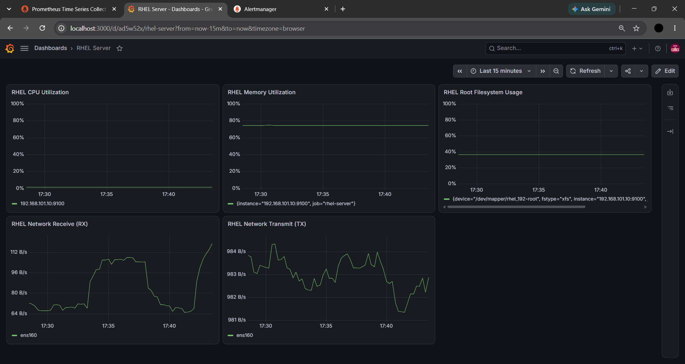
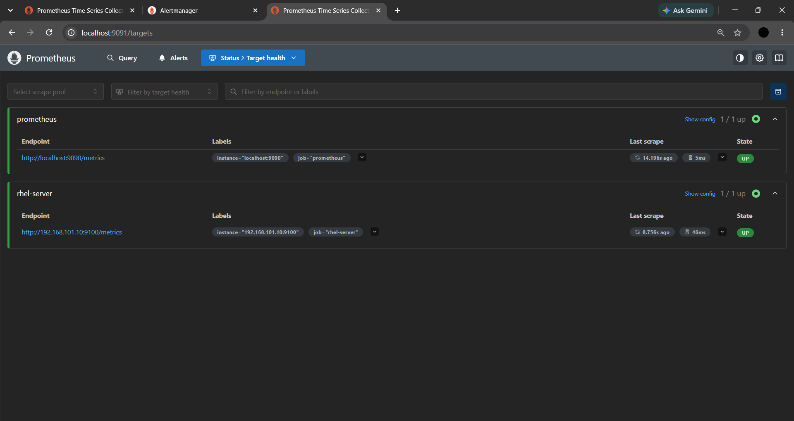
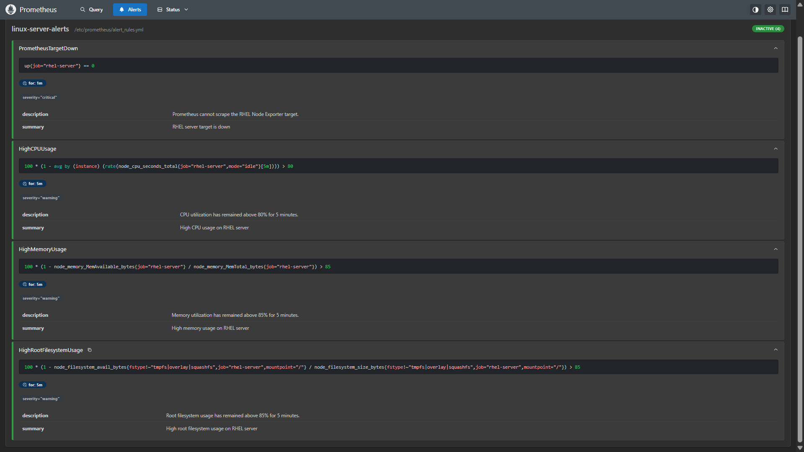
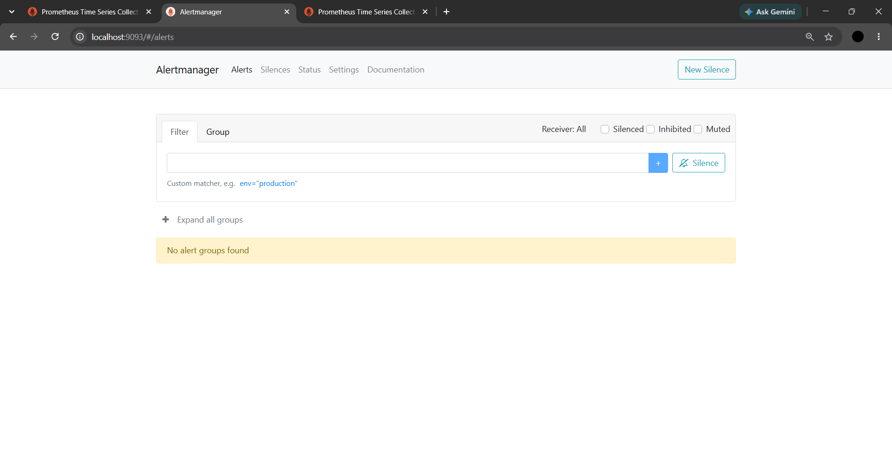
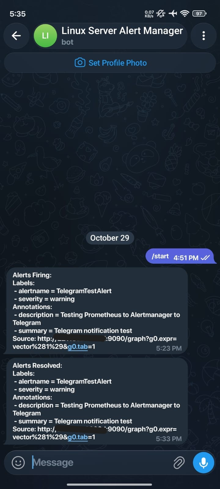

# Linux Server Monitoring & Incident Response Lab

A hands-on infrastructure monitoring project focused on Linux server observability, metrics collection, alerting, troubleshooting, and incident documentation.

The lab uses a RHEL virtual machine, Node Exporter, Prometheus, Grafana, and Alertmanager to monitor server resources, visualize metrics, and deliver alert notifications through Telegram.

## Objectives

- Deploy and monitor a Linux server in a virtualized environment.
- Collect Linux system metrics using Node Exporter.
- Configure Prometheus to scrape and query server metrics.
- Build a Grafana dashboard for CPU, memory, disk, and network monitoring.
- Configure Prometheus alert rules for common server issues.
- Integrate Alertmanager with Telegram for alert notifications.
- Practice infrastructure troubleshooting and document findings.

## Architecture

```text
RHEL 10.2 Virtual Machine
└── Node Exporter :9100
        │
        │ Metrics scraping
        ▼
Prometheus :9090 (container)
└── Host port :9091
        ├── Grafana :3000
        │   └── Linux Server Monitoring Dashboard
        │
        └── Alertmanager :9093
            └── Telegram Bot Notifications
```

Prometheus collects metrics from the RHEL server, evaluates alert rules, and forwards matching alerts to Alertmanager. Alertmanager handles notification routing and sends messages to Telegram.

## Technology Stack

| Component | Purpose |
|---|---|
| RHEL 10.2 | Monitored Linux server |
| VMware | Virtualization |
| Node Exporter 1.12.1 | Exposes Linux system metrics |
| Prometheus | Metrics collection, querying, and alert evaluation |
| Grafana | Dashboard visualization |
| Alertmanager | Alert grouping, routing, and notification delivery |
| Telegram Bot API | Delivers alert notifications |
| Docker Desktop | Runs monitoring containers |
| Ubuntu on WSL | Project workspace and Git workflow |
| Bash | Configuration rendering and automation |
| Git | Version control and documentation history |

## Monitoring Dashboard

The Grafana dashboard visualizes five metrics:

| Panel | Purpose |
|---|---|
| CPU Utilization | Estimates CPU usage from idle CPU time |
| Memory Utilization | Estimates memory usage from available memory |
| Root Filesystem Usage | Tracks used space on the root filesystem |
| Network Receive (RX) | Incoming traffic on `ens160` |
| Network Transmit (TX) | Outgoing traffic on `ens160` |

### Dashboard Evidence



Prometheus target status:



## Alerting and Notifications

Prometheus is configured with four initial alert rules:

| Alert | Trigger condition | Duration | Severity |
|---|---|---|---|
| `PrometheusTargetDown` | RHEL server scrape target is down | 1 minute | Critical |
| `HighCPUUsage` | CPU utilization above 80% | 5 minutes | Warning |
| `HighMemoryUsage` | Memory utilization above 85% | 5 minutes | Warning |
| `HighRootFilesystemUsage` | Root filesystem utilization above 85% | 5 minutes | Warning |

These thresholds are initial lab values and should be adjusted to suit the workload and operational requirements before production use.

### Alerting Evidence

Final Prometheus alert rules:



Alertmanager interface:



Telegram notification test:



The end-to-end test verified that a temporary Prometheus test alert could be evaluated, forwarded to Alertmanager, and delivered to Telegram. The temporary test rule was subsequently removed.

### Secret Handling

- Telegram bot token is stored outside the repository.
- `.env` is excluded from Git.
- `configs/alertmanager.yml.template` provides the version-controlled configuration template.
- `scripts/render-alertmanager-config.sh` renders the local Alertmanager configuration.
- The rendered `configs/alertmanager.yml` is excluded from Git because it contains sensitive configuration values.

Never commit bot tokens, private credentials, or other sensitive configuration values.

## Repository Structure

```text
linux-server-monitoring-lab/
├── configs/
│   ├── alert_rules.yml
│   ├── alertmanager.yml.template
│   └── prometheus.yml
├── docs/
│   ├── day-2-grafana-monitoring.md
│   └── day-3-prometheus-alerting.md
├── incident-reports/
│   └── day-1-troubleshooting.md
├── scripts/
│   └── render-alertmanager-config.sh
├── screenshots/
│   ├── alert_validation.png
│   ├── alertmanager_alerts.png
│   ├── grafana_dashboard.png
│   ├── grafana_dashboard_day3.png
│   ├── prometheus_alerts.png
│   ├── prometheus_targets.png
│   ├── prometheus_targets_day3.png
│   └── telegram_test_notification.jpeg
├── .gitignore
└── README.md
```

The locally rendered Alertmanager configuration and `.env` are intentionally excluded from the repository.

## Project Progress

- [x] Day 1 — Prometheus deployment and Node Exporter connectivity verification
- [x] Day 1 — Troubleshooting notes and incident documentation
- [x] Day 2 — Grafana deployment and Prometheus data source integration
- [x] Day 2 — CPU, memory, root filesystem, and network traffic dashboard
- [x] Day 2 — Dashboard screenshots and technical documentation
- [x] Day 3 — Prometheus alert-rule configuration and validation
- [x] Day 3 — Alertmanager deployment and integration
- [x] Day 3 — Telegram notification integration and end-to-end testing
- [x] Day 3 — Alert testing, cleanup, and technical documentation

## Accessing the Services

When the containers and monitored VM are running:

- Prometheus: `http://localhost:9091`
- Grafana: `http://localhost:3000`
- Alertmanager: `http://localhost:9093`

The RHEL Node Exporter endpoint is configured as `192.168.101.10:9100` in `configs/prometheus.yml`.

These addresses and network settings are specific to the current lab environment and may need to be adjusted on another machine.

## Documentation

- [Day 1 — Troubleshooting Report](incident-reports/day-1-troubleshooting.md)
- [Day 2 — Grafana Monitoring](docs/day-2-grafana-monitoring.md)
- [Day 3 — Prometheus Alerting and Telegram Notifications](docs/day-3-prometheus-alerting.md)

## Current Limitations and Next Steps

- Alert thresholds are initial lab settings and have not been tuned against production workloads.
- Notification delivery latency requires further investigation; a delay of approximately 3–4 minutes was observed during testing.
- The lab has verified basic notification delivery but has not yet completed a full simulated incident-response exercise.
- Future work may include controlled failure injection, recovery verification, and additional operational monitoring scenarios.

## Disclaimer

This repository documents a personal learning lab. Configuration details and results reflect the current local environment and should be adapted and tested before use in production.
