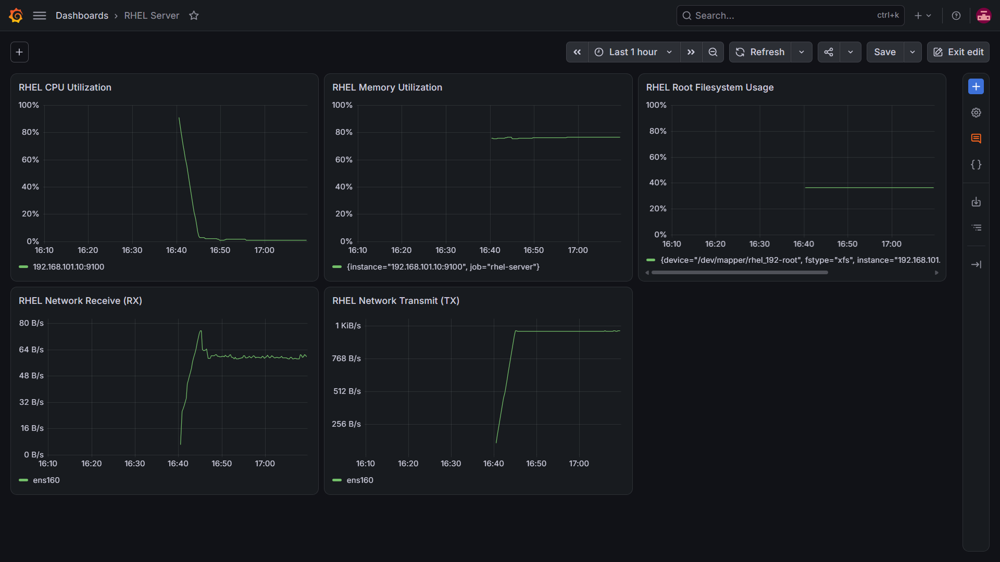
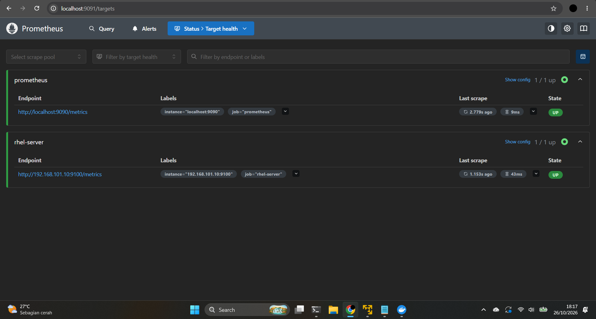

# Linux Server Monitoring & Incident Response Lab

A hands-on infrastructure monitoring project focused on Linux server observability, metrics collection, troubleshooting, and incident documentation.

The lab uses a RHEL virtual machine, Node Exporter, Prometheus, and Grafana to monitor server resource utilization and network traffic.

## Objectives

- Deploy and monitor a Linux server in a virtualized environment.
- Collect Linux system metrics using Node Exporter.
- Configure Prometheus to scrape and query server metrics.
- Build a Grafana dashboard for CPU, memory, disk, and network monitoring.
- Practice infrastructure troubleshooting and document findings.
- Establish a foundation for future alerting and incident-response exercises.

## Architecture

```text
RHEL 10.2 Virtual Machine
  └── Node Exporter :9100
          │
          │ Prometheus scrapes metrics
          ▼
Prometheus :9090 (container)
  └── Host port :9091
          │
          │ Grafana data source
          ▼
Grafana :3000
  └── Linux Server Monitoring Dashboard
```

## Technology Stack

| Component | Purpose |
|---|---|
| RHEL 10.2 | Monitored Linux server |
| VMware | Virtualization |
| Node Exporter 1.12.1 | Exposes Linux system metrics |
| Prometheus | Metrics collection and querying |
| Grafana | Dashboard visualization |
| Docker Desktop | Runs Prometheus and Grafana containers |
| Ubuntu on WSL | Project workspace and Git workflow |
| Git | Version control and documentation history |

## Monitoring Dashboard

The saved Grafana dashboard visualizes five metrics:

| Panel | Purpose |
|---|---|
| CPU Utilization | Estimates CPU usage from idle CPU time |
| Memory Utilization | Estimates memory usage from available memory |
| Root Filesystem Usage | Tracks used space on the root filesystem |
| Network Receive (RX) | Incoming traffic on `ens160` |
| Network Transmit (TX) | Outgoing traffic on `ens160` |

### Dashboard Evidence



Prometheus target status can also be reviewed in the following screenshot:



## Repository Structure

```text
linux-server-monitoring-lab/
├── configs/
│   └── prometheus.yml
├── docs/
│   └── day-2-grafana-monitoring.md
├── incident-reports/
│   └── day-1-troubleshooting.md
├── screenshots/
│   ├── grafana_dashboard.png
│   └── prometheus_targets.png
├── .gitignore
└── README.md
```

## Progress

- [x] Day 1 — Prometheus deployment and Node Exporter connectivity verification
- [x] Day 1 — Troubleshooting notes and incident documentation
- [x] Day 2 — Grafana deployment and Prometheus data source integration
- [x] Day 2 — CPU, memory, root filesystem, and network traffic dashboard
- [x] Day 2 — Dashboard screenshots and technical documentation
- [ ] Day 3 — Alerting and incident-response exercises

## Accessing the Services

When the containers and monitored VM are running:

- Prometheus: `http://localhost:9091`
- Grafana: `http://localhost:3000`

The RHEL Node Exporter endpoint is configured as `192.168.101.10:9100` in `configs/prometheus.yml`.

These addresses are specific to the current lab environment and may need to be adjusted on another machine.

## Documentation

- [Day 1 — Troubleshooting Report](incident-reports/day-1-troubleshooting.md)
- [Day 2 — Grafana Monitoring](docs/day-2-grafana-monitoring.md)

## Current Limitations and Next Steps

- The dashboard currently focuses on visualization; alert rules and notification integrations have not yet been implemented.
- Dashboard persistence depends on the Grafana storage configuration.
- Future work may include Prometheus alerting, Alertmanager, notification delivery, and simulated incident-response scenarios.

## Disclaimer

This repository documents a personal learning lab. Configuration details and results reflect the current local environment and should be adapted before use in production.
